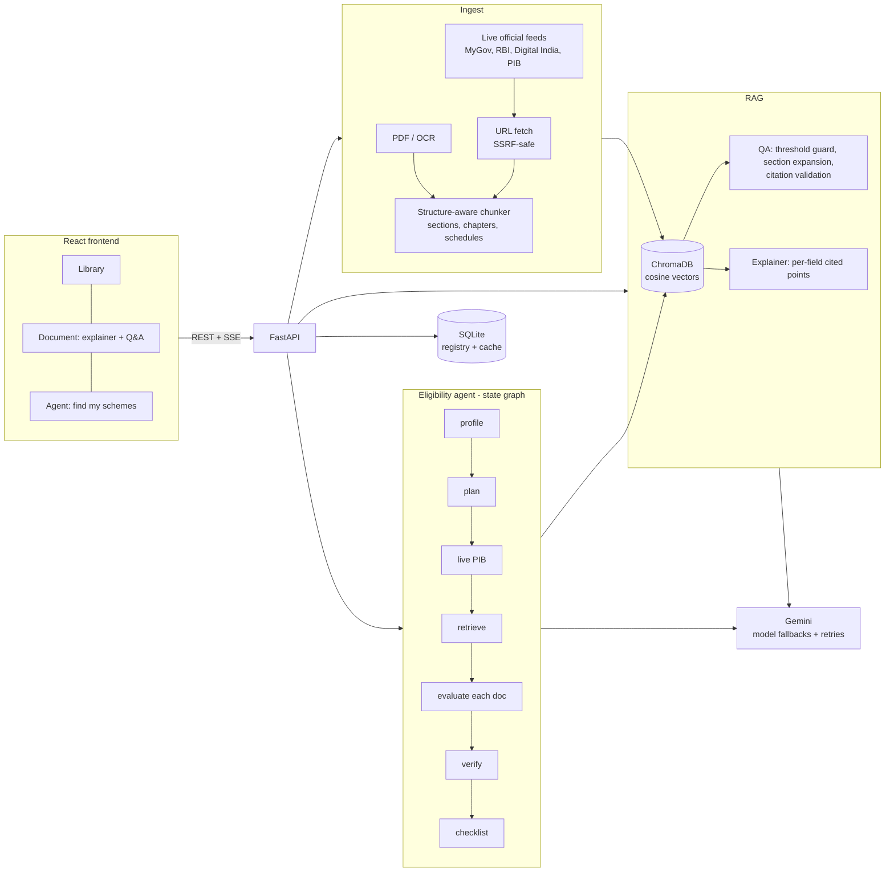

# Haq — your rights and schemes, in your language
🌐 **Live Demo:** [HaQ – Civic Copilot](https://haq-civic-copilot.vercel.app/)

💻 **GitHub Repository:** [Srijan-bit-ctrl/Haq](https://github.com/Srijan-bit-ctrl/Haq)

Haq turns official government documents into plain, regional-language explainers and tells a citizen
**which schemes they qualify for — with the exact source for every answer.**

Built for Forge · Theme 1 (Civic Pulse, Digital Governance & Public Information) ·
*Multilingual Policy, Rights & Scheme Explainer*.

## What it does

| Feature | How |
|---|---|
| **Explain any document** | Upload a PDF or paste a link. Haq writes a simple explainer in 12 Indian languages, for a **citizen** (rights, eligibility, documents, deadlines) or a **small business** (obligations, penalties, deadlines, licences). Every point links to the exact words it came from. Share it on WhatsApp or copy it in one click. |
| **Ask questions** | Question answering over one document or the whole library. If the document does not contain the answer, Haq says so instead of guessing. |
| **Scheme-eligibility agent** | Describe yourself (typing or voice). An agent builds your profile, asks for missing facts, searches the library, compares each rule with your details, and returns ranked schemes with a document checklist. The steps stream live. |
| **Live official sources** | Imports from any government PDF / page link, and reads live official feeds (MyGov, RBI, Digital India; PIB is tried too but currently refuses automated access, and the app says so instead of working around it). |
| **Voice in and out** | Browser speech recognition for input. Read-aloud uses a voice installed on the device for the chosen language; if the device has none (common on Windows for Indian languages) the server speaks it instead (Gemini speech, cached on disk). |
| **Clean audio** | The speech model adds a click at the start and a loud noise burst at the end of every clip (measured on real recordings). `backend/llm/audio.py` removes both automatically, with safeguards so real speech is never cut, and `tests/test_audio.py` covers it. |
| **Voice input that works everywhere** | Press Speak and talk in your language. Haq first tries the browser's own recogniser; if that is unavailable or fails (common: it depends on a Google service), it automatically records your voice and transcribes it on the server with Gemini (`POST /stt`). Specific messages tell you if the microphone is blocked or missing. It is fast: recording stops by itself 1.2 s after you stop talking, silence is trimmed, and the server uses a dedicated fast path (AI "thinking" switched off, quickest models first, a slow model is hedged by starting the next one in parallel): about 2.5–4 s to transcribe, so the words appear about 5 s after your last word. |
| **Voice notes** | Download any spoken explainer as an audio file (WAV) and forward it, for people who prefer listening or cannot read. |
| **Accessible, civic-portal design** | A government-portal style interface (utility bar, tricolor strip, breadcrumbs, service tiles, full footer) with text-size controls (A− / A+), a **high-contrast mode**, skip link, keyboard focus outlines, light layout that works on phones. It states clearly that it is an independent tool, not an official government site. |
| **Whole interface in your language** | Choosing a language changes everything, not just the AI's answers: menus, buttons, headings, form labels, example sentences, progress messages and error messages are all translated into the 12 languages, with right-to-left layout for Urdu. The language picker shows each language in its own script (हिन्दी, বাংলা, اردو…), so people can find theirs without reading English. Headlines from live government feeds, document titles, scheme names, and the agent's progress lines are translated too (by the AI, saved in the database so each text is translated once; a translation that mixes scripts is rejected and redone). |
| **Any source language** | Documents written in Hindi or other Indian languages are ingested too (sections are detected in any script) and can be explained or questioned in any of the 12 languages. |

## Architecture



### The agent (`backend/agent/graph.py`)

`profile → plan → live → retrieve → evaluate → verify → checklist`

* **profile** – extracts facts from free text, merges form fields, and if too little is known **stops and asks follow-up questions** (in the user's language) instead of guessing.
* **plan** – the LLM writes search queries; a rule-based plan is the fallback.
* **catalog** – tool use: picks official scheme documents that fit the profile from `sources/catalog.py` (a list of readable official links, no scheme data) and fetches them live if they are not in the library yet.
* **live** – tool use: reads the latest announcements from every reachable official feed, the LLM picks the relevant ones, and they are fetched and ingested. A source that is down or refuses access is skipped and reported.
* **retrieve / evaluate** – per document, every eligibility rule is marked `met / unmet / unknown` against the profile with citations. Invalid JSON is fed back to the model for one self-correction.
* **verify (guardrails)** – statements without a real retrieved source are **dropped**, and the verdict is **recomputed from the evidence** (any unmet rule → not eligible; any unknown → likely) rather than trusting the model.
* Every failure degrades gracefully: an unreachable source, a busy model or a bad document becomes a warning, never a crash.

### Anti-hallucination guardrails
1. Retrieval distance threshold – weak matches never reach the LLM ("Not found in the document").
2. The model must cite chunk ids; ids that were not retrieved are discarded.
3. Points with no valid citation are removed from explainers and agent results.
4. Temperature 0, "use only the sources" prompts, numbers and dates kept verbatim.

## Measured quality
`python backend/eval/run_eval.py` (backend running, real AI) asks questions about two real official documents
(National Commission for Women Act 1990, PM-KISAN guidelines) and checks the answers:

| Check | Result |
|---|---|
| In-scope questions answered with the correct fact | **8 / 8** |
| Answers that carry a real source citation | **8 / 8** |
| Off-topic questions correctly refused ("Not found in the document") | **6 / 6** |

Honest caveats: the set is small, and retrieval was improved after one question failed (see below), so treat this as a
sanity check, not a benchmark. Retrieval is **hybrid** — semantic vectors fused with BM25 keyword ranking — because pure
semantic search ranked the section that literally answers *"How many members does the Commission have?"* (Section 3)
below five less relevant ones. When a law contradicts itself (its introduction says six members, Section 3 says five plus a
Member-Secretary) the answer trusts the operative section and mentions the difference.

## Run it locally

Requirements: Python 3.12+ (tested on 3.14), Node 20+, a free [Gemini API key](https://aistudio.google.com/apikey).
Optional: [Tesseract](https://github.com/tesseract-ocr/tesseract) for scanned PDFs.

```bash
# 1. backend
cd backend
python -m venv venv && source venv/bin/activate        # Windows: venv\Scripts\activate
pip install -r requirements.txt
cp ../.env.example .env                                  # then put your GEMINI_API_KEY in it
uvicorn main:app --reload --port 8000

# 2. frontend (second terminal)
cd frontend
npm install
npm run dev                                              # http://localhost:5173 (proxies to :8000)
```

> **Windows tip:** if `pip install` fails with a “No such file or directory … .tmp” error, the folder path is too long
> (260-character limit). Keep the project in a short path such as `C:\forge`.

### Single-service build (what you deploy)
```bash
cd frontend && npm install && npm run build      # creates frontend/dist
cd ../backend && uvicorn main:app --port 8000    # serves the API *and* the built UI
```
Or use Docker: `docker build -t haq . && docker run -p 8000:8000 -e GEMINI_API_KEY=... -v haq-data:/app/backend/data haq`.
Deploy that image to Render / Railway / Fly.io / Hugging Face Spaces (Docker) and set `GEMINI_API_KEY`.

## Docs for the submission
* [`docs/DEPLOYMENT.md`](docs/DEPLOYMENT.md) — get a live URL (Render / Hugging Face / Railway), smoke test, quota advice
* [`docs/DEMO_SCRIPT.md`](docs/DEMO_SCRIPT.md) — 2–3 minute live demo script and likely judge questions
* [`docs/Haq-pitch-deck.pptx`](docs/Haq-pitch-deck.pptx) — 7-slide pitch deck (add team names on slide 1)

## Translating the interface
The master text is `frontend/src/i18n/English.json` (about 290 short texts). The other languages are generated from it with the
real AI:

```bash
cd backend
python tools/translate_ui.py                 # languages that have no file yet
python tools/translate_ui.py --only Tamil --force
```
Each result is verified (all keys present, every `{placeholder}` kept) and `tests/test_i18n.py` guards it. These are **machine
translations**: ask a native speaker to review them (especially legal and scheme wording) before a public launch. To change a
sentence, edit it in the language's JSON file, or edit `English.json` and re-run the tool with `--force`.

## Speed note: AI "thinking"
The Gemini models "think" before answering, which by default takes 10–40 s per call; the agent makes about 10 calls per run. Haq switches
thinking off (or to LOW for models that refuse "off") for all its AI calls and remembers what each model accepts, which brings an
agent run from over a minute to about 20 s with unchanged measured accuracy. Set `LLM_THINKING=default` to restore the models'
own behaviour.

## Tests
```bash
cd backend && pytest tests -q
```
Tests run offline using a stand-in AI that lives only in `backend/tests/` and covers ingestion, QA, explainer,
the agent (including guardrails and the follow-up questions), SSRF protection and error paths.
`python tests/serve_fake.py` starts the app with that stand-in so the UI can be clicked through without a key —
**never use it for the demo or deployment**.

## API

| Method | Path | Purpose |
|---|---|---|
| GET | `/health`, `/languages` | status, supported languages |
| GET / DELETE | `/documents`, `/documents/{id}` | library |
| POST | `/ingest` (PDF upload), `/ingest/url` | add documents |
| GET | `/sources/catalog` | official scheme documents (with import status) |
| GET | `/sources/live` | live official announcements + which sources answered |
| POST | `/stt` | speech to text: a short WAV recording in, the spoken words out |
| POST | `/tts` | spoken audio (WAV) for a short text (the UI joins pieces into a downloadable voice note) |
| POST | `/explain`, `/ask` | explainer, Q&A (`doc_id: "all"` = whole library) |
| POST | `/agent/run` | eligibility agent, streamed as Server-Sent Events |

## Data policy
Haq contains **no hard-coded or mock data**. Everything it shows comes from documents the user uploads or links,
or from live official feeds, and is processed by the live AI backend at request time.

## Project layout
```
backend/  main.py  config.py  db.py
          ingestion/ (pdf, chunker, web)   rag/ (store, qa, explain)   agent/graph.py
          sources/feeds.py   services/documents.py   llm/ (client, languages)   tests/
frontend/ src/ (api, hooks, App, pages/, components/)
```
